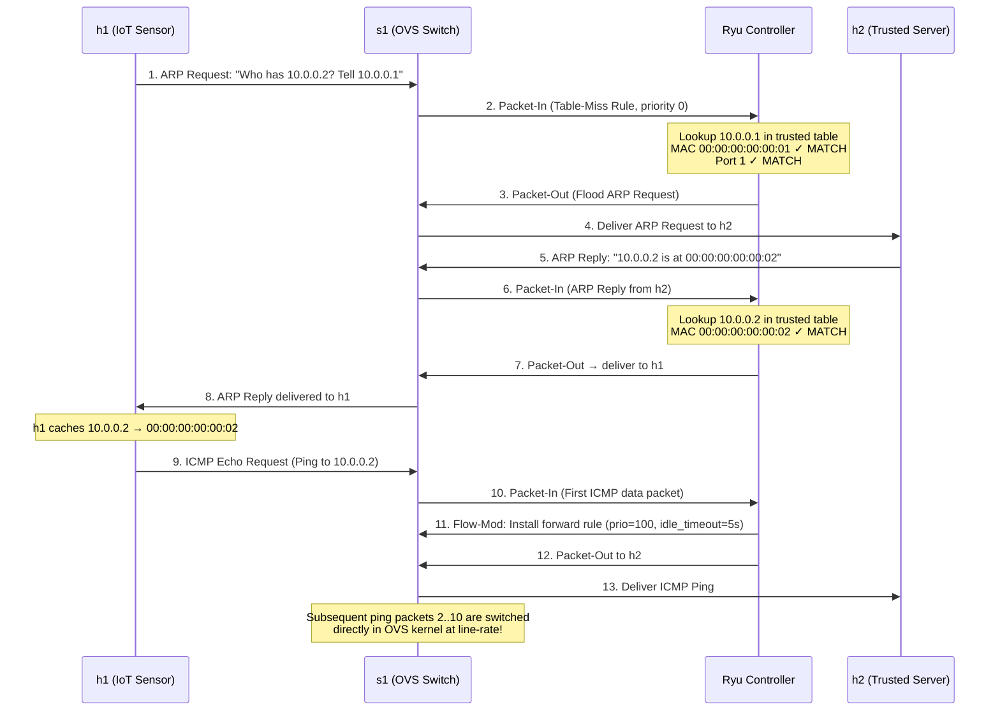
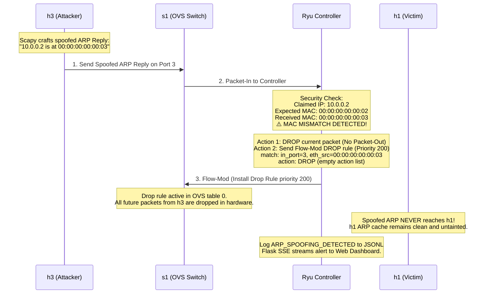

# IoTShield: SDN-Based ARP Spoofing Detection and Man-in-the-Middle Attack Prevention in IoT Networks

> **Academic Lab Project** — End-Semester Assignment  
> **Technologies:** Python 3 · Ryu SDN Controller · Mininet · Open vSwitch (OVS) · OpenFlow 1.3 · Scapy · Flask · HTML5/CSS3/Chart.js

---

## Table of Contents

1. [Quick Start & Demo Guide (3-Terminal Setup)](#1-quick-start--demo-guide-3-terminal-setup)
2. [Commands Reference](#2-commands-reference)
3. [Technology Stack & Role of Each Tool](#3-technology-stack--role-of-each-tool)
4. [Is Docker Used in this Project? (Why / Why Not?)](#4-is-docker-used-in-this-project-why--why-not)
5. [System Architecture & Workflow Diagrams](#5-system-architecture--workflow-diagrams)
6. [Hinglish Q&A & Viva Doubts Guide](#6-hinglish-qa--viva-doubts-guide)
7. [Reset / Clear Data Mechanism](#7-reset--clear-data-mechanism)
8. [Folder Structure](#8-folder-structure)
9. [Detailed Technical Viva Q&A (English)](#9-detailed-technical-viva-qa-english)

---

## 1. Quick Start & Demo Guide (3-Terminal Setup)

For the best live demonstration experience in front of the evaluator, open **3 terminal tabs/windows in Ubuntu (WSL 2)**:

```
┌───────────────────────────────┐ ┌───────────────────────────────┐
│ Terminal 1: Mininet CLI       │ │ Terminal 2: Ryu Controller    │
│ (Network & Attack Simulation) │ │ (Filtered Security Log)       │
└───────────────────────────────┘ └───────────────────────────────┘
┌───────────────────────────────┐ ┌───────────────────────────────┐
│ Terminal 3: Security Monitor  │ │ Windows Browser:              │
│ (Real-time Event Stream)      │ │ http://localhost:5000         │
└───────────────────────────────┘ └───────────────────────────────┘
```

### Terminal 1: Start the Entire Lab & Interactive Mininet CLI
```bash
cd /mnt/c/Users/hmury/Desktop/IOT_EndLab_Assignment/iotshield
sudo bash scripts/start_lab.sh
```
*What happens:* OVS starts, Ryu controller starts, Flask backend starts, clean table-miss rule is verified, and you enter the `mininet>` prompt.

### Terminal 2: Human-Readable Ryu Controller Monitor
```bash
cd /mnt/c/Users/hmury/Desktop/IOT_EndLab_Assignment/iotshield
python3 scripts/watch_ryu.py
```
*What happens:* Shows clean, color-coded controller logs. All internal Python/eventlet deprecation warnings are automatically filtered out.

### Terminal 3: Formatted Security Event Stream
```bash
cd /mnt/c/Users/hmury/Desktop/IOT_EndLab_Assignment/iotshield
python3 scripts/watch_events.py
```
*What happens:* Formats `/tmp/iotshield_events.jsonl` into readable boxes: Safe traffic in green, ARP Spoofing alerts in high-visibility red boxes with fake vs real MAC.

### Web Browser:
Open on Windows: **`http://localhost:5000`**
- Split-screen SOC layout (Left: Stats + Timeline Chart + Event Feed | Right: SVG Topology + SDN Binding Table).

---

## 2. Commands Reference

All commands are run directly inside **Terminal 1 (`mininet>` prompt)**:

### 1. Normal Legitimate Traffic Test:
```bash
mininet> h1 ping -c 3 h2
```
- **What happens:**
  - `h1` sends ARP request to find `h2`'s MAC.
  - Ryu validates that `10.0.0.1` matches MAC `00:00:00:00:00:01` on Switch Port 1.
  - Ryu installs an OpenFlow forwarding rule (`priority 100, idle_timeout 5s`).
  - `0% packet loss` is achieved.
  - **Terminal 2 & 3:** `🟢 SAFE ICMP 10.0.0.1 → 10.0.0.2` is logged.
  - **Web UI:** Packets Inspected count increments, green packet animation runs from `h1 → s1 → h2`.

### 2. Launch ARP Spoofing Attack:
```bash
mininet> h3 python3 attacks/arp_spoof.py --count 10
```
- **What happens:**
  - Attacker `h3` (Port 3, MAC `00:00:00:00:00:03`) sends 10 gratuitous ARP replies claiming: *"10.0.0.2 is at 00:00:00:00:00:03"*.
  - Ryu controller inspects the packet against `config/trusted_bindings.json`.
  - **MISMATCH DETECTED:** Expected MAC for `10.0.0.2` is `00:00:00:00:00:02`, but received `00:00:00:00:00:03`!
  - Ryu drops the rogue packet immediately and sends an OpenFlow Flow-Mod to install a hardware **DROP rule (`priority 200`)** on switch `s1` for port 3 / attacker MAC.
  - Subsequent 9 spoofed packets are dropped directly in hardware by OVS.
  - **Terminal 2 & 3:** Alert printed: `🚨 ARP SPOOFING DETECTED — MITM BLOCKED!`.
  - **Web UI:** 1.2s non-blocking toast alert appears, `h3` node turns red (`QUARANTINED`), Attacks Flagged and Packets Blocked counters increment.

### 3. Verify Mitigation & Attacker Isolation:
```bash
mininet> h1 ping -c 3 h2
```
- **What happens:** `0% packet loss`. Legitimate IoT communication between sensor and server is 100% unaffected.

### 4. Reset & Re-arm for Another Live Demo:
- Click the **"Reset / Clear Data"** button in the Web UI top-right corner, OR run in any terminal:
```bash
sudo bash scripts/reset_lab.sh
```
- All drop rules are removed, table-miss rule is re-instated, host ARP caches are flushed, and all UI counters reset to 0. You can re-run the demo immediately!

---

## 3. Technology Stack & Role of Each Tool

| Technology | Category | Role in IoTShield |
|:---|:---|:---|
| **Python 3.12** | Core Programming Language | Powers the Ryu SDN controller application, backend API, attack generator script, and test suite. |
| **Ryu SDN Controller** | SDN Control Plane Framework | An event-driven OpenFlow controller. It receives Packet-In events from OVS, parses ARP/ICMP packets, validates them against trusted bindings, and installs OpenFlow flow rules. |
| **Open vSwitch (OVS)** | SDN Data Plane (Virtual Switch) | A production-grade multi-layer virtual switch running in the Linux kernel. It switches legitimate frames at line-rate and executes hardware drop rules installed by Ryu. |
| **Mininet (2.3.0)** | Network Emulator | Creates the isolated network topology (`h1`, `h2`, `h3`, `s1`) using real Linux network namespaces and virtual ethernet (`veth`) pairs. |
| **OpenFlow 1.3** | SDN Protocol | The standardized south-bound communication protocol connecting OVS (data plane) and Ryu (control plane) over TCP port 6633. |
| **Scapy (2.5.0)** | Packet Crafting Library | Used in `attacks/arp_spoof.py` to craft raw, customized, gratuitous ARP reply packets to simulate realistic ARP poisoning. |
| **Flask (3.0)** | Dashboard Backend API | Lightweight web framework that tails the controller JSONL event log and exposes REST endpoints and a Server-Sent Events (SSE) stream. |
| **Server-Sent Events (SSE)** | Real-Time Push Protocol | Pushes live security events from the Flask server to the browser over a persistent HTTP connection (`/api/events/stream`). |
| **Chart.js & SVG** | Frontend Visualization | Renders the live dark-themed SOC dashboard with interactive network topology, animated packet paths, and rolling traffic activity charts. |
| **pytest** | Automated Unit Testing | Runs 59 comprehensive unit tests verifying binding tables, metrics math, and event serialization without needing Mininet. |

---

## 4. Is Docker Used in this Project? (Why / Why Not?)

### **Answer: NO, Docker is NOT used in this project.**

#### **Why Docker was NOT used:**
1. **Mininet & OVS Require Direct Linux Kernel Access:**
   Mininet relies heavily on Linux network namespaces (`ip netns`), virtual ethernet pairs (`veth`), and kernel-level Open vSwitch datapath (`openvswitch.ko`). Running Mininet inside Docker requires running containers in privileged mode (`--privileged`) with host kernel module mounting, which creates fragile networking bottlenecks and permission conflicts.
2. **WSL 2 Native Ubuntu Environment is Superior:**
   Because your environment is **Ubuntu 24.04 on WSL 2 (Windows Subsystem for Linux)**, WSL 2 provides a real, modern Linux kernel (Linux 5.15+). Running Open vSwitch, Mininet, and Ryu directly inside WSL 2 gives **native kernel speed, zero virtualization overhead, and 100% stability**.
3. **Simpler, Beginner-Friendly Setup:**
   Direct execution eliminates Docker port-forwarding issues, container IP mapping bugs, and daemon startup races. Everything runs transparently on `localhost:5000` and `localhost:6633`.

*(Docker Desktop remains installed on your Windows machine, but IoTShield does not touch or depend on it.)*

---

## 5. System Architecture & Workflow Diagrams

### 5.1 High-Level Architecture

```
  ┌─────────────────────────────────────────────────────────────┐
  │                     CONTROL PLANE                           │
  │                  Ryu SDN Controller                         │
  │             (controller/sdn_guard.py)                       │
  │                                                             │
  │   ┌──────────────────────────┐  ┌────────────────────────┐  │
  │   │  Trusted Bindings Table  │  │   Classification Logic │  │
  │   │  (IP ↔ MAC ↔ OVS Port)   │  │   (Spoof / Legit / Unk)│  │
  │   └─────────────┬────────────┘  └───────────┬────────────┘  │
  └─────────────────┼───────────────────────────┼───────────────┘
     OpenFlow 1.3   │ Flow-Mod (Priority 200/100)│ Packet-In
     TCP Port 6633  ▼                           │
  ┌─────────────────────────────────────────────┼───────────────┐
  │                     DATA PLANE              ▲               │
  │               Open vSwitch (s1)             │               │
  │                                             │               │
  │    Port 1 (eth1)          Port 2 (eth2)     │ Port 3 (eth3) │
  └─────────┬──────────────────────┬────────────┴───────┬───────┘
            │                      │                    │
            ▼                      ▼                    ▼
     ┌──────────────┐       ┌──────────────┐     ┌──────────────┐
     │      h1      │       │      h2      │     │      h3      │
     │  IoT Sensor  │       │Trusted Server│     │ Attacker Node│
     │   (Victim)   │       │              │     │ (Compromised)│
     │  10.0.0.1    │       │  10.0.0.2    │     │  10.0.0.3    │
     └──────────────┘       └──────────────┘     └──────────────┘
```

---

### 5.2 Packet Flow: Normal Legitimate Traffic



---

### 5.3 Packet Flow: ARP Spoofing Attack Detection & Mitigation



---

## 6. Hinglish Q&A & Viva Doubts Guide

Here are the exact answers to common viva questions and practical lab behavior:

### Q1: UI me "Packets Inspected" count ka kya matlab hai?
**Ans:** **Packets Inspected** ka matlab hai ki **SDN Controller (Ryu) ne kitne packets ko apne paas receive karke security policy ke through check kiya**.
- Isme **Legitimate Packets** (jaise `h1` ka valid ARP aur ICMP request) aur **Malicious Packets** (jaise `h3` ke spoofed ARP packets) dono shamil hote hain.
- Formula: $\text{Packets Inspected} = \text{Legitimate Packets} + \text{Blocked / Attack Packets}$.

---

### Q2: Jab hum `h1 ping -c 10 h2` karte hain (10 packets bheje), toh pehli baar count 4 kyun badhta hai, aur 10 kyun nahi?
**Ans:** Yeh **Software-Defined Networking (SDN) ka core principle** hai:
1. **Packet 1 (ARP Request):** `h1 → Controller` $\rightarrow$ Count = 1
2. **Packet 2 (ARP Reply):** `h2 → Controller` $\rightarrow$ Count = 2
3. **Packet 3 (ICMP Ping #1 Request):** Switch ke paas rule nahi tha, usne Controller ko bheja $\rightarrow$ Count = 3 *(Controller ne switch me rule daal diya: port 1 se port 2 forward karo)*.
4. **Packet 4 (ICMP Ping #1 Reply):** Wapsi me Controller ke paas gaya $\rightarrow$ Count = 4 *(Controller ne reverse rule daal diya)*.
- **Baki ke 8 packets kahan gaye?** Rules install hone ke baad packets 2 se 10 tak direct **OVS switch ke hardware/kernel level par microsecond speed (0.07 ms)** par chale gaye! Unhe controller ke paas jane ki zaroorat nahi padi.
- **Viva Point:** *"Sir, control plane (Ryu) only inspects initial packets to enforce policy and install flows. Data plane (OVS) forwards subsequent packets at wire-speed without overloading the controller."*

---

### Q3: Pehle 10 ping ke baad jab dobara 4 ping bhejte hain, toh count sirf 2 kyun badhta hai?
**Ans:** Kyunki is baar **ARP resolution dobara nahi karni padi**:
- 5 second baad switch ka ICMP rule expire hua.
- Dobara ping karne par `h1` ke paas `h2` ka MAC pehle se tha, toh usne koi ARP nahi bheja.
- Sirf **1 ICMP Request** aur **1 ICMP Reply** controller ke paas gaye (Count = 2). Baki 3 pings direct switch se deliver ho gaye.

---

### Q4: ARP aur ICMP me kya difference hai? Aur 1 single ping bhejne par background me kya hota hai?
**Ans:**
- **ARP (Address Resolution Protocol - Layer 2):** IP address se hardware MAC address dhoondhta hai (*"10.0.0.2 kiska IP hai? Apna MAC address batao"*).
- **ICMP (Internet Control Message Protocol - Layer 3):** Actual ping testing ka packet hota hai (*"Hello 10.0.0.2, kya tum alive ho? Reply karo"*).
- **Jab 1 ping bhejte hain:**
  1. Pehle **ARP Request** jaata hai.
  2. Phir **ARP Reply** aata hai (MAC mil gaya).
  3. Phir **ICMP Echo Request** jaata hai.
  4. Phir **ICMP Echo Reply** aata hai.
  *(Pehle rasta dhoondha jata hai ARP se, fir data jata hai ICMP se).*

---

### Q5: `idle_timeout = 5 seconds` ka kya matlab hai?
**Ans:** Yeh switch ka **Inactivity Timer** hota hai:
- Jab tak lagataar ping chal raha hai, rule switch me bana rehta hai.
- Jaise hi 5 second tak koi packet nahi aata, switch samajhta hai ki conversation khatam ho gayi, aur memory saaf karne ke liye us rule ko **automatically delete** kar deta hai.
- **Fayda:** Switch ki flow table over-fill nahi hoti, aur security re-verification ensure hoti hai.

---

### Q6: Agar switch se rule delete ho gaya, toh dubara ping karne par ARP kyun nahi hota?
**Ans:** Kyunki **Switch ki memory (Flow Table)** aur **Host ki memory (OS ARP Cache)** do alag cheezein hain:
- Rule switch `s1` se delete hua.
- Lekin `h1` ke apne computer (Linux OS) ki memory me `h2` ka MAC address abhi bhi yaad hai (Linux ARP cache timeout aamtaur par 60s hota hai).
- Isliye `h1` ko naya ARP bhejne ki zaroorat nahi padti.

---

### Q7: Attack block hone ke baad agar evaluator ko dubara attack dikhana ho, toh kya poora project restart karna padega?
**Ans:** **Nahi!** Aapko project restart karne ki bilkul zaroorat nahi hai:
- UI ke top-right me **"Reset / Clear Data"** button dabayein.
- Yeh switch se attacker ka drop rule delete kar dega, host ka ARP cache flush kar dega, aur UI counters 0 kar dega.
- Aap bina terminal band kiye evaluator ke saamne turant dubara attack run karke detection aur blocking dikha sakte hain.

---

## 7. Reset / Clear Data Mechanism

Jab aap Web Dashboard par **"Reset / Clear Data"** click karte hain ya `scripts/reset_lab.sh` run karte hain, system yeh 4 steps perform karta hai:

1. **OVS Flow Rules Reset:** Attacker `h3` ka priority 200 drop rule delete hota hai, aur clean `priority 0, actions=controller` table-miss rule re-instate hota hai.
2. **Mininet Host ARP Flush:** Har host ke Linux namespace me `ip neigh flush all` chalta hai taaki agla ping fresh ARP resolution trigger kare.
3. **Ryu Controller State Reset:** Controller trigger file `/tmp/iotshield_reset.trigger` detect karke apne internal stats aur active drop caches ko zero kar deta hai.
4. **Web UI Synchronized Reset:** SSE stream se `RESET` event aate hi UI ke saare counters 0 ho jaate hain, `h3` node wapas cyan (NORMAL) ho jata hai, aur events feed clear ho jata hai.

---

## 8. Folder Structure

```
iotshield/
├── README.md                      ← Comprehensive documentation (this file)
├── LICENSE                        ← MIT License
├── requirements.txt               ← Python dependencies (ryu, flask, scapy, etc.)
│
├── config/
│   ├── trusted_bindings.json      ← Static IP ↔ MAC ↔ Port truth table
│   └── settings.json              ← Controller IP/port, topology definitions
│
├── controller/
│   ├── sdn_guard.py               ← Ryu application: OpenFlow 1.3 ARP inspection & flow rules
│   └── event_logger.py            ← Structured JSONL security event logger
│
├── topology/
│   └── iot_topology.py            ← Mininet topology (h1, h2, h3, s1)
│
├── attacks/
│   └── arp_spoof.py               ← Scapy ARP spoofing attack generator
│
├── backend/
│   ├── app.py                     ← Flask API & SSE event streaming server
│   ├── event_service.py           ← Real-time log file tailing & event queue
│   ├── lab_manager.py             ← Lab process status & zero-restart reset engine
│   └── metrics.py                 ← Detection latency & prevention rate formulas
│
├── frontend/
│   ├── index.html                 ← Split-screen dark SOC dashboard
│   ├── css/styles.css             ← Modern high-contrast cybersecurity styling
│   └── js/
│       ├── app.js                 ← Application coordinator & SSE event listener
│       ├── dashboard.js           ← Status cards & live event feed manager
│       ├── topology.js            ← SVG network graph with live packet animations
│       └── charts.js              ← Real-time Chart.js rolling traffic activity
│
├── docs/
│   ├── manual_print.html          ← Printable A4 lab manual for submission
│   ├── architecture.md            ← Deep architecture specifications
│   ├── viva_questions.md          ← Comprehensive viva preparation guide
│   └── troubleshooting.md         ← WSL2 & OpenFlow troubleshooting
│
├── scripts/
│   ├── start_lab.sh               ← One-command complete lab startup
│   ├── stop_lab.sh                ← Clean lab shutdown
│   ├── reset_lab.sh               ← Standalone reset & ARP flush script
│   ├── watch_ryu.py               ← Terminal 2 clean Ryu controller monitor
│   └── watch_events.py            ← Terminal 3 formatted security event monitor
│
└── tests/                         ← 59 automated unit tests (100% pass)
```

---

## 9. Detailed Technical Viva Q&A (English)

### Q: Why is the drop rule priority 200 while forwarding rules are priority 100?
**Ans:** OpenFlow switches evaluate rules strictly by priority (highest priority first). If a malicious host starts sending packets after a forwarding rule (priority 100) was already installed, the drop rule (priority 200) will take precedence and immediately block the packet. Security enforcement rules must always supersede forwarding rules.

### Q: How does IoTShield prevent controller saturation from ARP flooding?
**Ans:** IoTShield implements immediate flow-rule offloading. When an attack is flagged, Ryu installs a drop rule on OVS with `actions=[]`. The very next attack packet is dropped directly by OVS in the Linux kernel without sending a Packet-In to the controller.

### Q: Why use OpenFlow 1.3 instead of OpenFlow 1.0?
**Ans:** OpenFlow 1.3 provides explicit Table-Miss flow entries, multiple flow tables, IPv6 match extensions, and instruction-based actions (`OFPIT_APPLY_ACTIONS`) which are essential for modern SDN security architectures.
