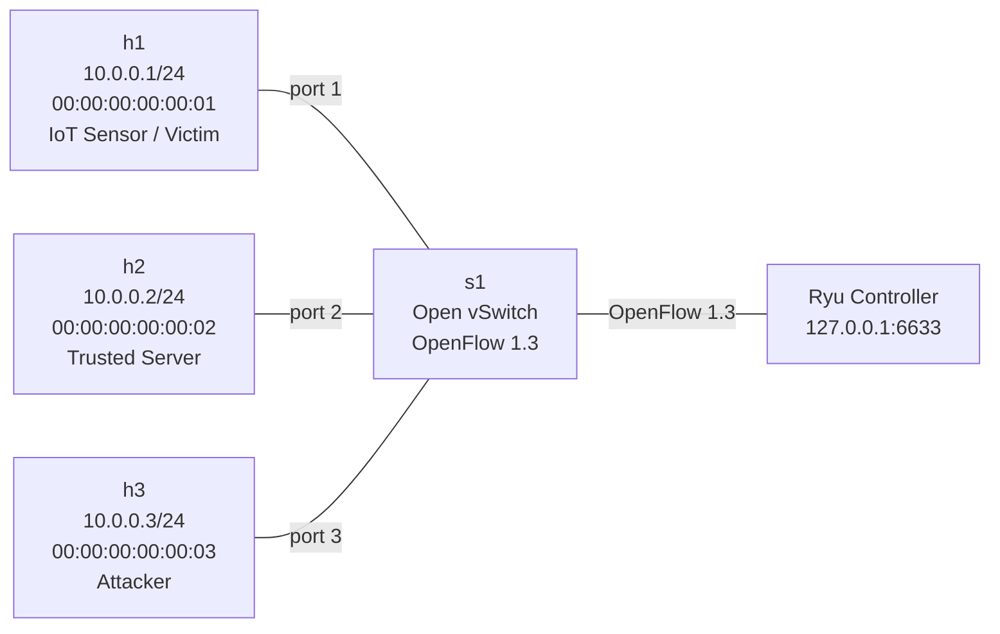
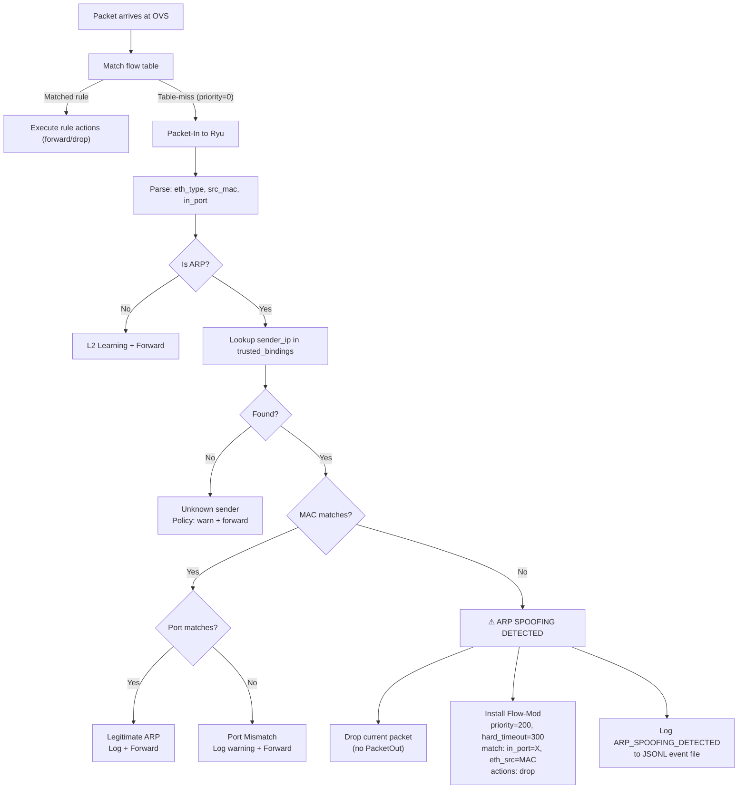
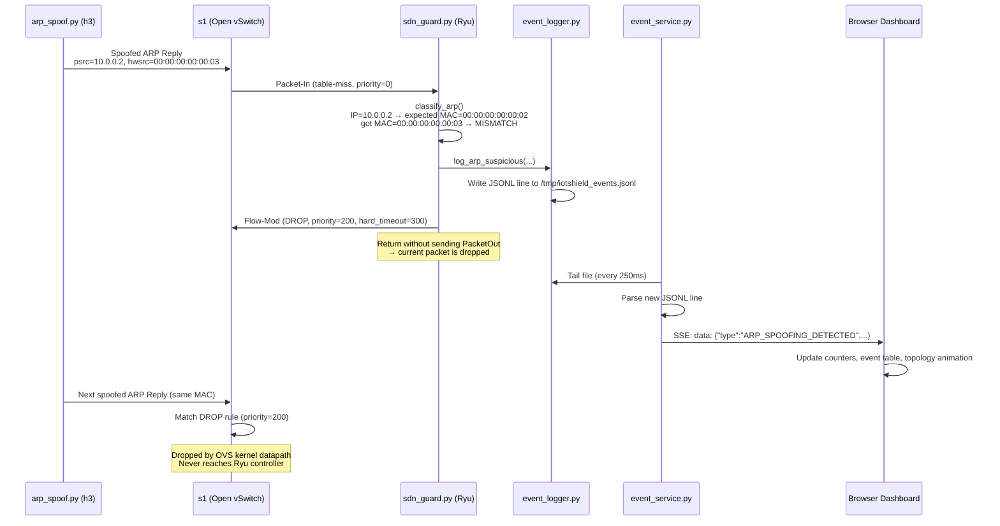
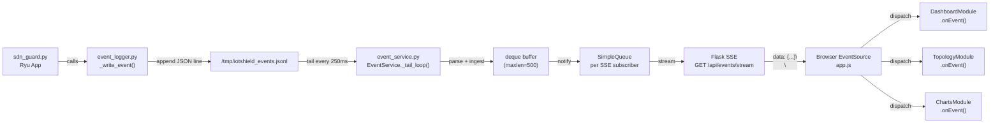

# IoTShield Architecture

## Component Overview

IoTShield consists of four loosely-coupled layers communicating through files, ports, and HTTP:

```
┌─────────────────────────────────────────────────────┐
│  Data Plane (Mininet + OVS)                         │
│  h1 ─── s1 ─── h2                                  │
│          │                                           │
│         h3                                          │
└──────────────┬──────────────────────────────────────┘
               │ OpenFlow 1.3 (TCP :6633)
┌──────────────▼──────────────────────────────────────┐
│  Control Plane (Ryu)                                │
│  sdn_guard.py  ←→  event_logger.py                 │
│                          │                           │
│                    JSONL event log                   │
└──────────────────────────┬──────────────────────────┘
                           │ file tail (250ms poll)
┌──────────────────────────▼──────────────────────────┐
│  API Layer (Flask)                                   │
│  app.py  ←→  event_service.py  ←→  metrics.py      │
└──────────────────────────┬──────────────────────────┘
                           │ HTTP / SSE
┌──────────────────────────▼──────────────────────────┐
│  Presentation Layer (Browser)                       │
│  index.html  app.js  dashboard.js  topology.js      │
└─────────────────────────────────────────────────────┘
```

## Mininet Topology



## ARP Processing Pipeline



## OpenFlow Flow Rule Table

| Priority | Match | Actions | Purpose |
|---|---|---|---|
| 200 | `in_port=3, eth_src=00:00:00:00:00:03` | `drop` | Block attacker MAC (installed on detection) |
| 100 | `in_port=1, eth_dst=00:00:00:00:00:02` | `output:2` | Forward h1→h2 traffic |
| 100 | `in_port=2, eth_dst=00:00:00:00:00:01` | `output:1` | Forward h2→h1 traffic |
| 0 | `*` (table-miss) | `CONTROLLER:65535` | Send unmatched packets to Ryu |

**Priority precedence:** Security (200) > Forwarding (100) > Table-miss (0)

## Attack-Detection Mitigation Sequence



## Data Flow: Events to Browser



